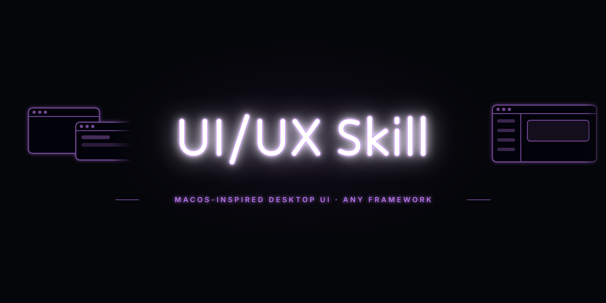
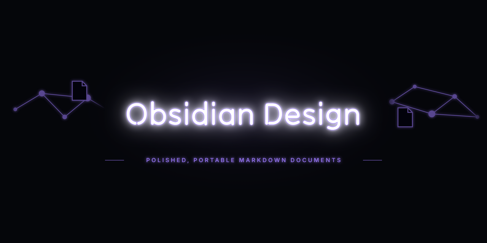
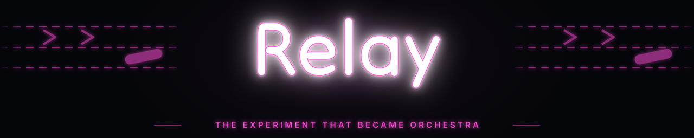
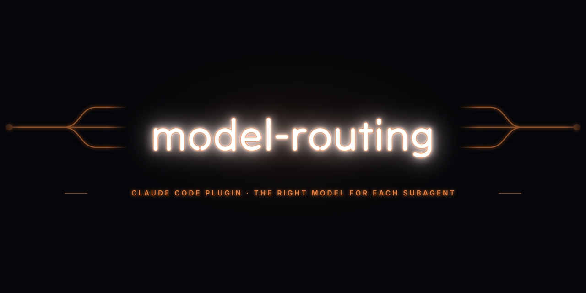
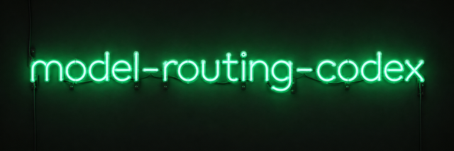
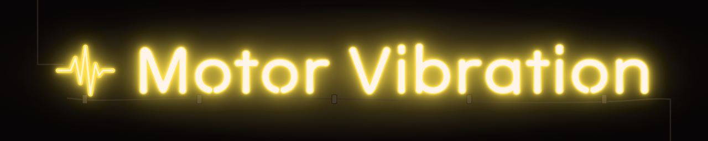

  

<a href="README.md">한국어</a> · <b>English</b>

## Hi, I'm LSY.KOR

I'm at Hanyang University, building robots, tools for hardware engineers, and tools that put AI coding agents to work.
Most of what's here started because something annoyed me while I was working.

## What I'm most into right now: Orchestra

  

A plugin where the Claude Code main session plans and reviews, and implementation goes to a Claude subagent or a Codex CLI worker picked by difficulty.
I pay for both Claude and Codex, and it bugged me that one quota always ran out first.
Three Codex workers built the web piano below. They all said "done", and the main-session review still found five issues.

  

## Projects

<table>
  <tr>
    <td width="50%" valign="top">
      
      
<b><a href="https://github.com/lsy041015/CircitHuB">CircitHuB</a></b> — Part search, AI datasheet analysis and team sharing in one desktop app.

    </td>
    <td width="50%" valign="top">
      
      
<b><a href="https://github.com/lsy041015/capstone-design-hanyang-university">Unmanned Laundry Pickup System</a></b> — A capstone concept: a 24-hour laundry pickup store designed in Blender.

    </td>
  </tr>
  <tr>
    <td width="50%" valign="top">
      
      
<b><a href="https://github.com/lsy041015/ui-ux-skill">UI/UX Skill</a></b> — An agent skill that designs and reviews desktop UI on macOS principles.

    </td>
    <td width="50%" valign="top">
      
      
<b><a href="https://github.com/lsy041015/Obsidian-Design">Obsidian Design</a></b> — A Codex skill for Obsidian and Markdown docs with real sources.

    </td>
  </tr>
  <tr>
    <td width="50%" valign="top">
      
      
<b><a href="https://github.com/lsy041015/relay">Relay</a></b> (archived) — The experiment before Orchestra, which it grew into.

    </td>
    <td width="50%" valign="top">
      
      
<b><a href="https://github.com/lsy041015/model-routing">model-routing</a></b> — A plugin that picks the right Claude model for each subagent task.

    </td>
  </tr>
  <tr>
    <td width="50%" valign="top">
      
      
<b><a href="https://github.com/lsy041015/model-routing-codex">model-routing-codex</a></b> — The same rules, ported to the Codex CLI.

    </td>
    <td width="50%" valign="top">
      
      
<b><a href="https://github.com/lsy041015/motor-vibration-anomaly">Motor Vibration Anomaly</a></b> — A machine-learning course project on motor vibration anomalies (Test F1 0.850).

    </td>
  </tr>
</table>

## A bit more

I usually split work so the main session plans and reviews and workers implement. A worker's "done" still gets checked against the diff and test output, and I try to put only checked numbers in my READMEs.
Mostly Python, PySide6, OpenCV, Blender, Claude Code and the Codex CLI.
