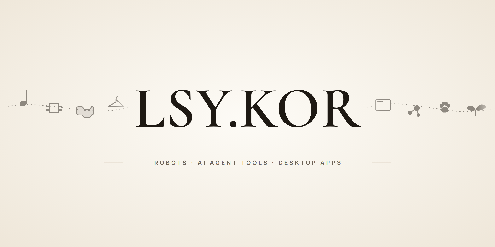
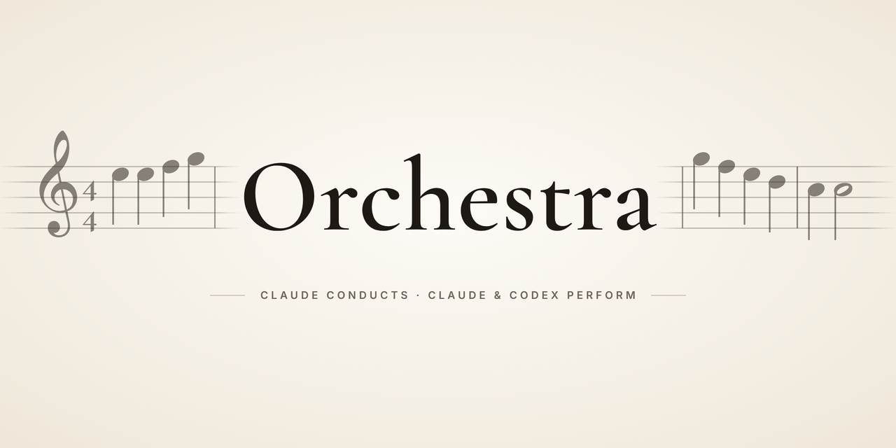
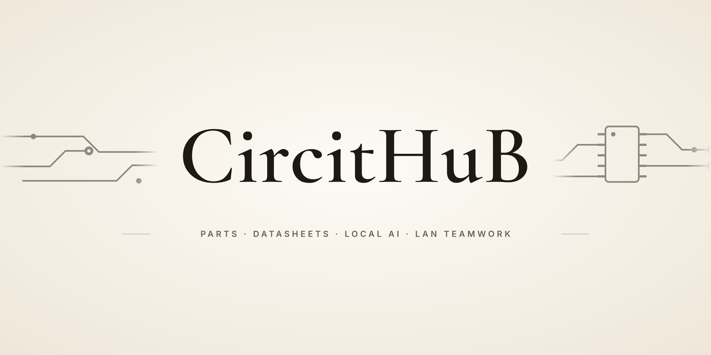
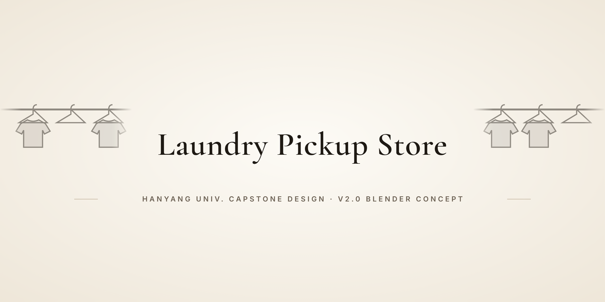
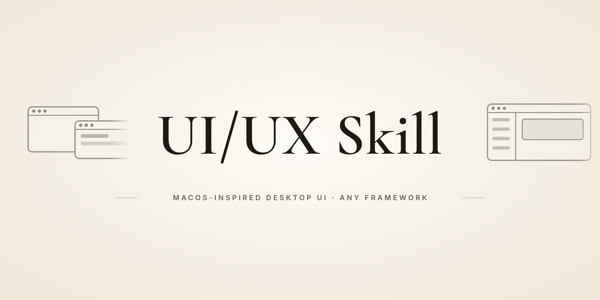
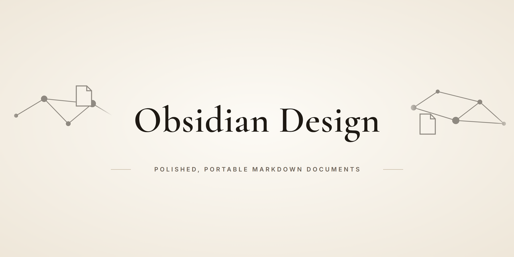
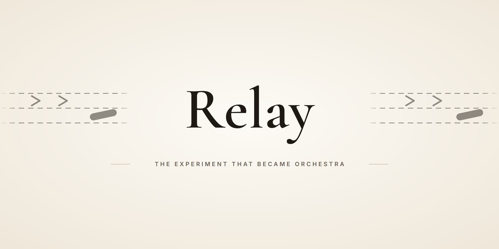

  

<a href="README.md">한국어</a> · <b>English</b>

## Hi, I'm LSY.KOR

At Hanyang University I build **robots**, **tools for hardware engineers**, and **tools that put AI coding agents to work**.
Most projects here started from a friction I hit while working:

- Jumping between a browser and English datasheets for every part → **CircitHuB**
- Paying for both Claude and Codex while only one quota runs out → **Orchestra**

---

## Main project: Orchestra

  

**The conductor plans. The right model plays.** A skill plugin where the Claude Code main session plans and reviews, and
each bounded implementation task goes to a **Claude subagent** or a **Codex CLI worker** chosen per difficulty tier.

- Workers show up in the task list with engine, model and effort, e.g. `[Codex gpt-6-luna/high] Task 3: …`.
- After each Codex run a script checks mechanically whether files outside the allowed list changed; the main session reviews the real diff.
- A recorded run: a web piano split into 3 tasks for 3 Codex workers (2 in parallel), 13 min 28 s of worker time.
  Every worker said "done", the main-session review still found 5 issues, and each task needed one fix round.

  

---

## Projects

<table>
  <tr>
    <td width="50%" valign="top">
      
      
<b><a href="https://github.com/lsy041015/CircitHuB">CircitHuB</a></b> — DigiKey part search, AI datasheet analysis and LAN team sharing in one PySide6 desktop app.

      
Python · PySide6 · Selenium · OpenCV · Tesseract · Ollama · Gemini

    </td>
    <td width="50%" valign="top">
      
      
<b><a href="https://github.com/lsy041015/capstone-design-hanyang-university">Unmanned Laundry Pickup System</a></b> — Hanyang University capstone design: an automated cell that stores and hands out garments and shoes, designed and checked in Blender (a concept).

      
Blender · robot cell design · design review

    </td>
  </tr>
  <tr>
    <td width="50%" valign="top">
      
      
<b><a href="https://github.com/lsy041015/ui-ux-skill">UI/UX Skill</a></b> — An agent skill for designing and reviewing desktop UI/UX on any framework, grounded in macOS principles.

      
Codex · Claude Code · Agent Skills

    </td>
    <td width="50%" valign="top">
      
      
<b><a href="https://github.com/lsy041015/Obsidian-Design">Obsidian Design</a></b> — A Codex skill for polished, portable Obsidian and Markdown documents with real sources and links.

      
Codex · Markdown · Obsidian

    </td>
  </tr>
  <tr>
    <td width="50%" valign="top">
      
      
<b><a href="https://github.com/lsy041015/relay">Relay</a></b> (archived) — The experiment before Orchestra: the main model plans, one fixed implementer codes. It continues as Orchestra.

      
Codex · Claude Code · Superpowers fork

    </td>
  </tr>
</table>

---

## Stories behind the projects

- **CircitHuB** splits AI in two: local Ollama `gemma4:e4b` for chat (cost, privacy, offline), cloud Gemini only for datasheet regions.
  Its main window is assembled from 9 mixins (search, parts, categories, chat, sharing, sidebar, …) instead of one giant class.
- **The laundry pickup cell** raised its design-review score from 32 to 74 with 10 recorded fixes, and its robot never grips
  fabric or shoes directly, only an adapter tab or a tray handle.
- **UI/UX Skill** keeps each of its 6 rule modules under 300 characters, so an agent reads only what it needs.

---

## Tools I use

| Area | Tools |
|---|---|
| Languages | Python, JavaScript, Bash |
| Desktop & web | PySide6 (Qt), Flask, Flask-SocketIO, Blockly, Three.js, cannon.js |
| Vision & documents | OpenCV, PyMuPDF, Tesseract OCR |
| AI | Claude Code, Codex CLI, Ollama (Gemma), Gemini API |
| Robots & 3D | Piper 6-axis arm (CAN), Blender, UR5 model |
| Dev tools | Git, GitHub Actions, Node.js |

---

This profile and every repository banner come from one generator; each repository gets its own small motif.

