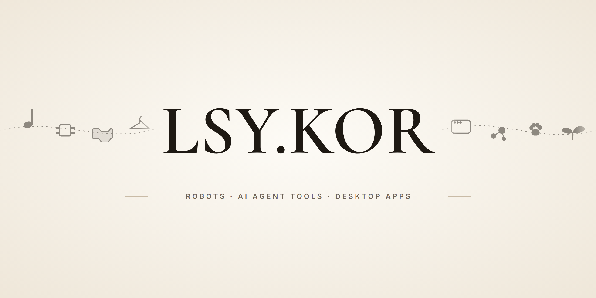
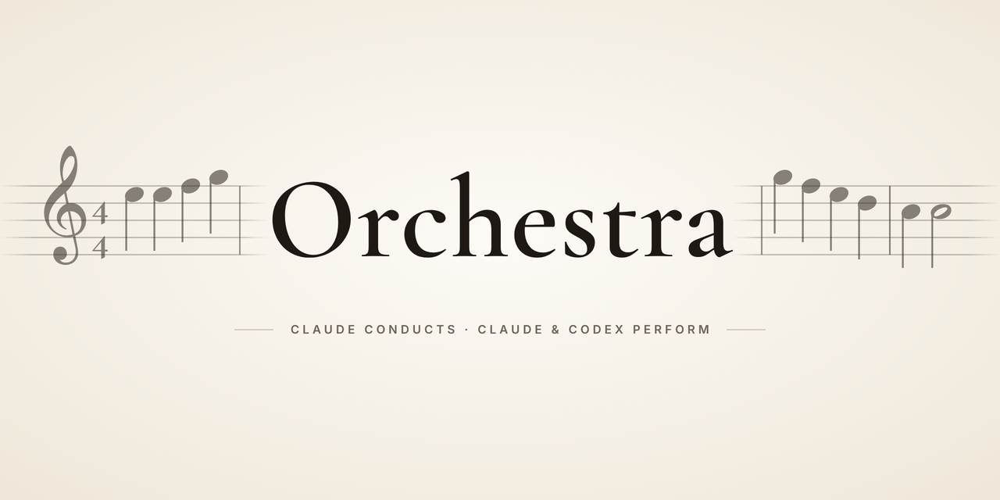
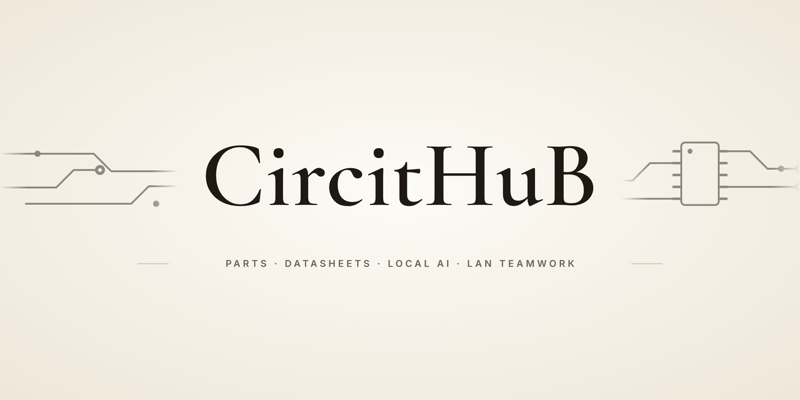
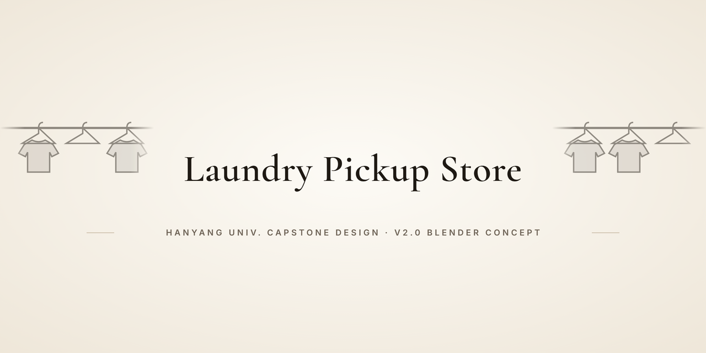
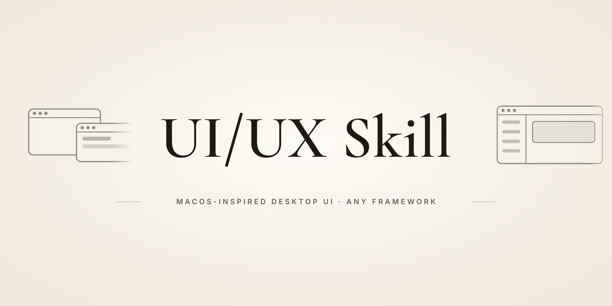
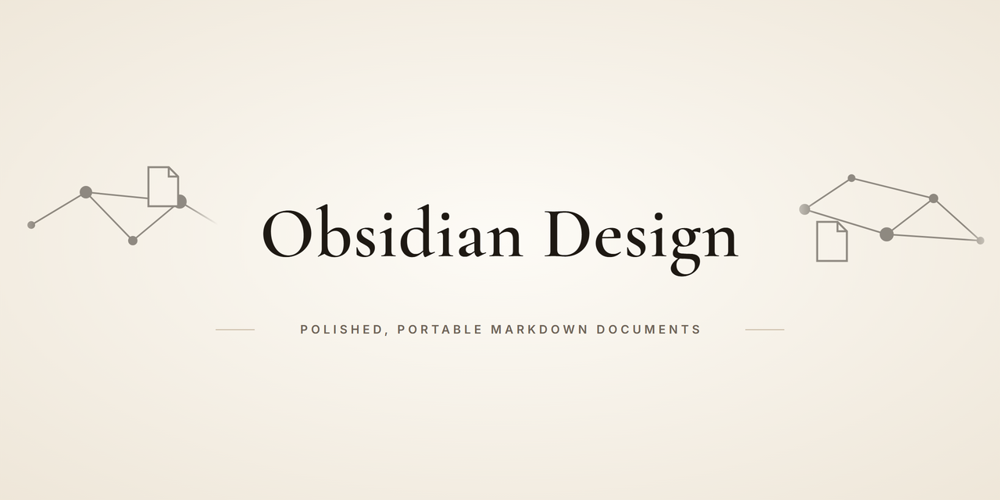
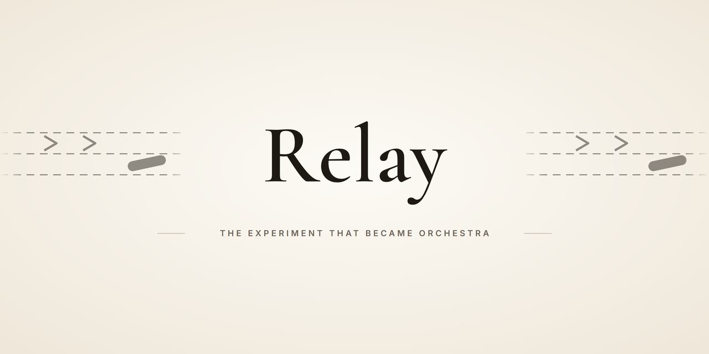

  

<b>한국어</b> · <a href="README.en.md">English</a>

## 안녕하세요, LSY.KOR입니다

한양대학교에서 **로봇**과 **하드웨어 엔지니어링 도구**, 그리고 **AI 코딩 에이전트를 부리는 도구**를 만듭니다.
여기 있는 프로젝트는 대부분 작업하다 부딪힌 불편이나 진입 장벽에서 시작했습니다.

- 부품 하나 찾을 때마다 브라우저와 영어 데이터시트를 오가는 일 → **CircitHuB**
- Claude와 Codex 구독을 둘 다 쓰는데 한쪽 한도만 먼저 바닥나는 일 → **Orchestra**

---

## 지금 가장 공들이는 것: Orchestra

  

**지휘는 메인 세션이, 연주는 알맞은 모델이.** Claude Code 메인 세션이 계획과 리뷰를 맡고, 범위가 정해진 구현은
난이도(쉬움·보통·어려움·UI)마다 고른 **Claude 서브에이전트** 또는 **Codex CLI 워커**에게 맡기는 스킬 플러그인입니다.

- 워커는 작업 목록에 `[Codex gpt-6-luna/high] Task 3: …`처럼 엔진·모델·추론 수준을 달고 나타납니다.
- Codex 워커가 끝나면 스크립트가 **허용한 파일 밖을 건드렸는지** 기계적으로 검사하고, 메인 세션이 실제 diff로 리뷰합니다.
- 실제 기록: 웹 피아노를 작업 3개로 나눠 Codex 워커 3개(2개는 병렬)에 맡겼더니 워커 시간 13분 28초.
  모든 워커가 "완료"라고 했지만 메인 세션 리뷰가 문제 5건을 더 찾았고, 작업마다 수정 한 번으로 끝났습니다.

  
   Orchestra 워커들이 만든 한 옥타브 웹 피아노. 연주곡은 환희의 송가.

---

## 프로젝트

<table>
  <tr>
    <td width="50%" valign="top">
      
      
<b><a href="https://github.com/lsy041015/CircitHuB">CircitHuB</a></b> — DigiKey 부품 검색, 데이터시트 AI 분석, LAN 팀 공유를 한 창에 모은 PySide6 데스크톱 앱.

      
Python · PySide6 · Selenium · OpenCV · Tesseract · Ollama · Gemini

    </td>
    <td width="50%" valign="top">
      
      
<b><a href="https://github.com/lsy041015/capstone-design-hanyang-university">무인 세탁물 수령 시스템</a></b> — 한양대 캡스톤 디자인. V2.0: 로비·셀프 빨래방·로봇 셀·직원 공간으로 된 24시 무인 세탁 수령소를 1:1 Blender 타임라인으로 설계·검증한 콘셉트.

      
Blender · 공정 설계 · 모션스터디

    </td>
  </tr>
  <tr>
    <td width="50%" valign="top">
      
      
<b><a href="https://github.com/lsy041015/ui-ux-skill">UI/UX Skill</a></b> — macOS 설계 원칙을 바탕으로 어떤 프레임워크든 데스크톱 앱 UI/UX를 설계·검토하게 하는 에이전트 스킬.

      
Codex · Claude Code · Agent Skills

    </td>
    <td width="50%" valign="top">
      
      
<b><a href="https://github.com/lsy041015/Obsidian-Design">Obsidian Design</a></b> — 출처와 링크가 살아 있는, 어디서든 읽히는 Obsidian·Markdown 문서를 쓰게 하는 Codex 스킬.

      
Codex · Markdown · Obsidian

    </td>
  </tr>
  <tr>
    <td width="50%" valign="top">
      
      
<b><a href="https://github.com/lsy041015/relay">Relay</a></b> (지난 실험) — 메인 모델이 계획하고 고정된 구현자 하나가 코딩하던 Orchestra 이전의 실험. 지금은 Orchestra로 이어졌습니다.

      
Codex · Claude Code · Superpowers 포크

    </td>
  </tr>
</table>

---

## 프로젝트마다 숨은 이야기

**CircitHuB**
- AI를 두 층으로 나눴습니다. 대화는 로컬 Ollama `gemma4:e4b`(비용·개인정보·오프라인), 데이터시트에서 고른 영역의 번역·요약만 클라우드 Gemini.
- 메인 창 하나를 믹스인 9개(검색·부품·카테고리·채팅·공유·사이드바 등)로 나눠 조립해, 거대한 클래스 하나가 되는 것을 피했습니다.
- 가격표 파서는 `$`·`₩`·`€`·`£`를 모두 알아보고, 사양 이름은 DigiKey의 한국어·영어 표기를 둘 다 받아들입니다.

**무인 세탁물 수령 시스템**
- 설계 검토 점수를 32점에서 74점으로 끌어올리며 고친 10가지를 그대로 기록했습니다. 옷 보관 칸을 10개에서 8개로 줄인 것도 그중 하나입니다.
- 로봇은 옷이나 신발을 직접 잡지 않습니다. 옷걸이 어댑터의 단단한 탭과 신발 트레이 손잡이만 잡도록 설계했습니다.
- 2분짜리 공정 영상에는 3,600프레임이 모두 정상 디코딩되는지, 장면 21개의 음량은 어떤지까지 적은 기계 판독용 검증 보고서가 붙어 있습니다.

**UI/UX Skill**
- 스킬의 규칙 모듈 6개가 전부 300자 이하입니다. 에이전트가 필요한 모듈만 읽어 문맥을 아끼도록 일부러 잘게 나눴습니다.

**Obsidian Design**
- 인용·측정값·담당자·마감일·테스트 결과·출처를 절대 지어내지 않도록 스킬에 못 박았습니다.

---

## 일하는 방식

<table>
  <tr>
    <td valign="top" width="50%">
      <b>계획과 리뷰는 한 곳에서</b> 
      Claude Code 메인 세션이 요구사항·설계·리뷰·검증을 맡고, 구현은 범위가 정해진 워커에게 나눕니다.
      워커의 "완료"는 증거가 아니라서 실제 diff와 테스트 출력으로 다시 확인합니다.
    </td>
    <td valign="top" width="50%">
      <b>수치로 말하기</b> 
      README에는 확인한 것만 씁니다. 캡스톤의 자동 검사 177개, CircitHuB 테스트 276개 중 274개 통과(남은 2개는 저장소 설정 파일)처럼,
      숫자에는 어떻게 쟀는지와 아직 안 되는 것이 함께 붙어 있습니다.
    </td>
  </tr>
</table>

---

## 자주 쓰는 도구

| 분야 | 도구 |
|---|---|
| 언어 | Python, JavaScript, Bash |
| 데스크톱·웹 | PySide6 (Qt), Flask, Flask-SocketIO, Blockly, Three.js, cannon.js |
| 비전·문서 | OpenCV, PyMuPDF, Tesseract OCR |
| AI | Claude Code, Codex CLI, Ollama (Gemma), Gemini API |
| 로봇·3D | Piper 6축 로봇 팔 (CAN), Blender, UR5 모델 |
| 개발 환경 | Git, GitHub Actions, Node.js |

---

이 프로필과 각 저장소의 배너는 같은 생성기로 만들었습니다. 저장소마다 오선·회로·블록·옷걸이 같은 작은 무늬가 다릅니다.

