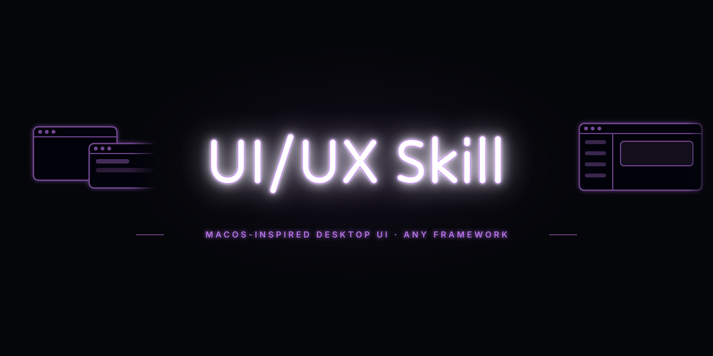
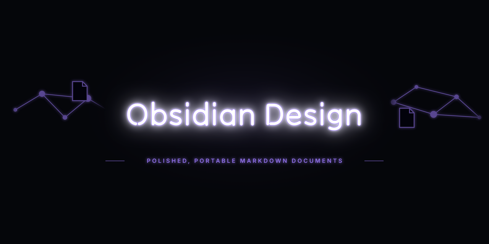
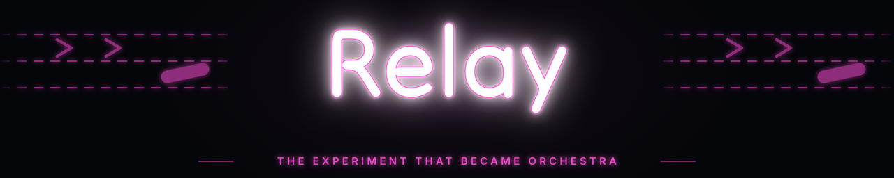
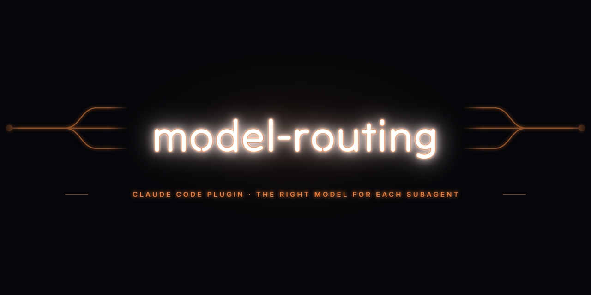
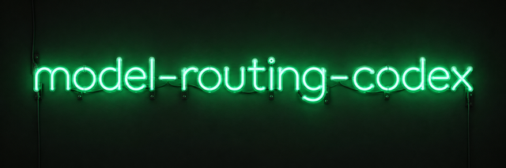
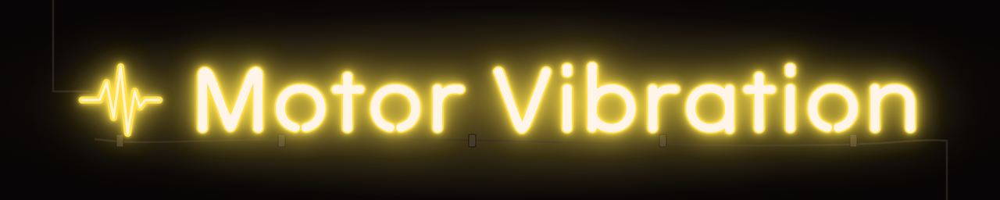

  

<b>한국어</b> · <a href="README.en.md">English</a>

## 안녕하세요, LSY.KOR이에요

한양대학교에서 로봇이랑 하드웨어 엔지니어링 도구, 그리고 AI 코딩 에이전트를 부리는 도구를 만들고 있어요.
대부분 작업하다 불편한 게 생겨서 시작한 것들이에요.

## 요즘 제일 붙잡고 있는 것: Orchestra

  

Claude Code 메인 세션이 계획과 리뷰를 맡고, 구현은 난이도에 맞춰 고른 Claude 서브에이전트나 Codex CLI 워커에게 넘기는 플러그인이에요.
Claude랑 Codex를 둘 다 구독하는데 한쪽 한도만 먼저 바닥나는 게 아까워서 만들었어요.
아래 웹 피아노는 Codex 워커 3개가 나눠 만든 건데, 다들 "완료"라고 했지만 메인 세션 리뷰에서 문제 5건이 더 나왔어요.

  

## 프로젝트

<table>
  <tr>
    <td width="50%" valign="top">
      
      
<b><a href="https://github.com/lsy041015/CircitHuB">CircitHuB</a></b> — 부품 검색, 데이터시트 AI 분석, 팀 공유를 한 창에 모은 데스크톱 앱.

    </td>
    <td width="50%" valign="top">
      
      
<b><a href="https://github.com/lsy041015/capstone-design-hanyang-university">무인 세탁물 수령 시스템</a></b> — 24시 무인 세탁 수령소를 Blender로 설계한 캡스톤 콘셉트.

    </td>
  </tr>
  <tr>
    <td width="50%" valign="top">
      
      
<b><a href="https://github.com/lsy041015/ui-ux-skill">UI/UX Skill</a></b> — macOS 원칙으로 데스크톱 UI를 설계·검토하는 에이전트 스킬.

    </td>
    <td width="50%" valign="top">
      
      
<b><a href="https://github.com/lsy041015/Obsidian-Design">Obsidian Design</a></b> — 출처가 살아 있는 Obsidian·Markdown 문서를 쓰게 하는 Codex 스킬.

    </td>
  </tr>
  <tr>
    <td width="50%" valign="top">
      
      
<b><a href="https://github.com/lsy041015/relay">Relay</a></b> (지난 실험) — Orchestra 이전 실험. 지금은 Orchestra로 이어졌어요.

    </td>
    <td width="50%" valign="top">
      
      
<b><a href="https://github.com/lsy041015/model-routing">model-routing</a></b> — 서브에이전트 작업마다 알맞은 Claude 모델을 고르는 플러그인.

    </td>
  </tr>
  <tr>
    <td width="50%" valign="top">
      
      
<b><a href="https://github.com/lsy041015/model-routing-codex">model-routing-codex</a></b> — 같은 규칙을 Codex CLI로 옮긴 버전.

    </td>
    <td width="50%" valign="top">
      
      
<b><a href="https://github.com/lsy041015/motor-vibration-anomaly">모터 진동 이상 탐지</a></b> — 기계학습론 IC-PBL, 모터 진동 이상 탐지 (Test F1 0.850).

    </td>
  </tr>
</table>

## 조금 더

일은 보통 메인 세션이 계획·리뷰하고 워커가 구현하는 식으로 나눠요. 워커가 "완료"라고 해도 diff랑 테스트 출력으로 다시 확인하고, README에는 확인한 숫자만 적으려고 해요.
주로 Python, PySide6, OpenCV, Blender, Claude Code, Codex CLI를 써요.
